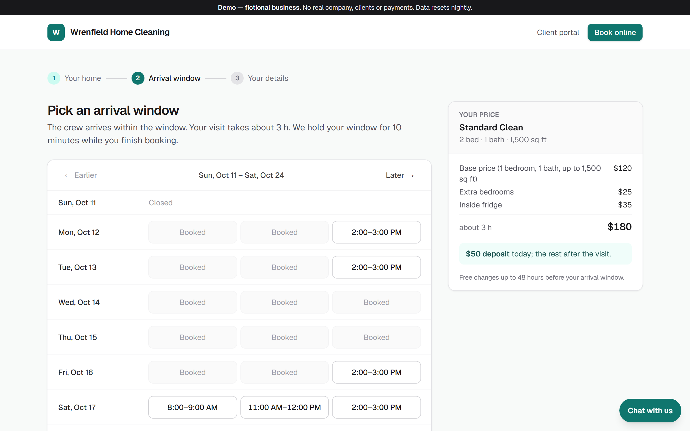
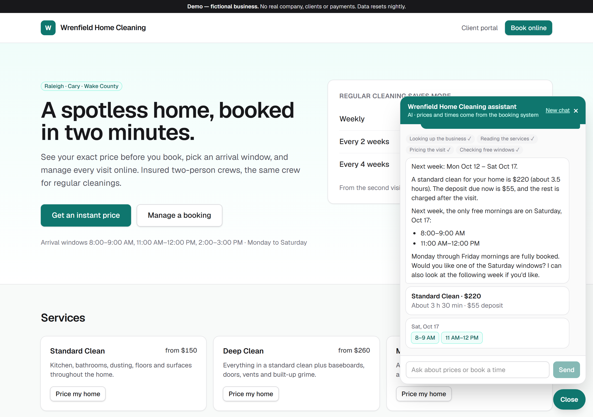
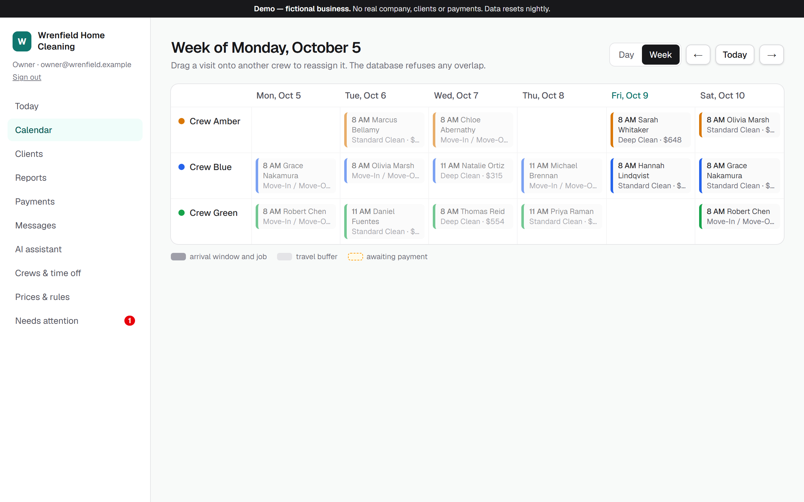
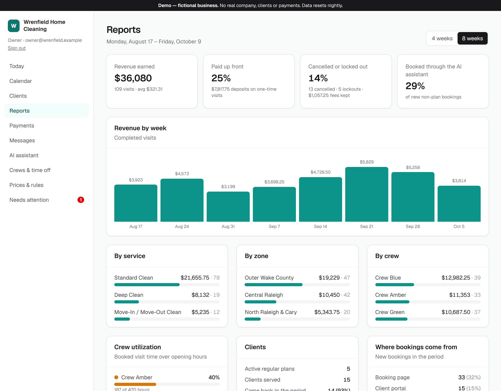
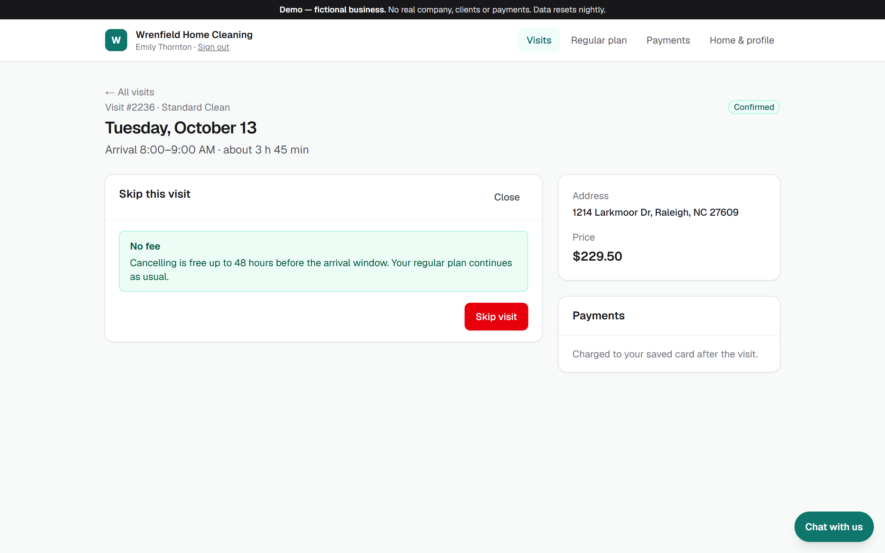
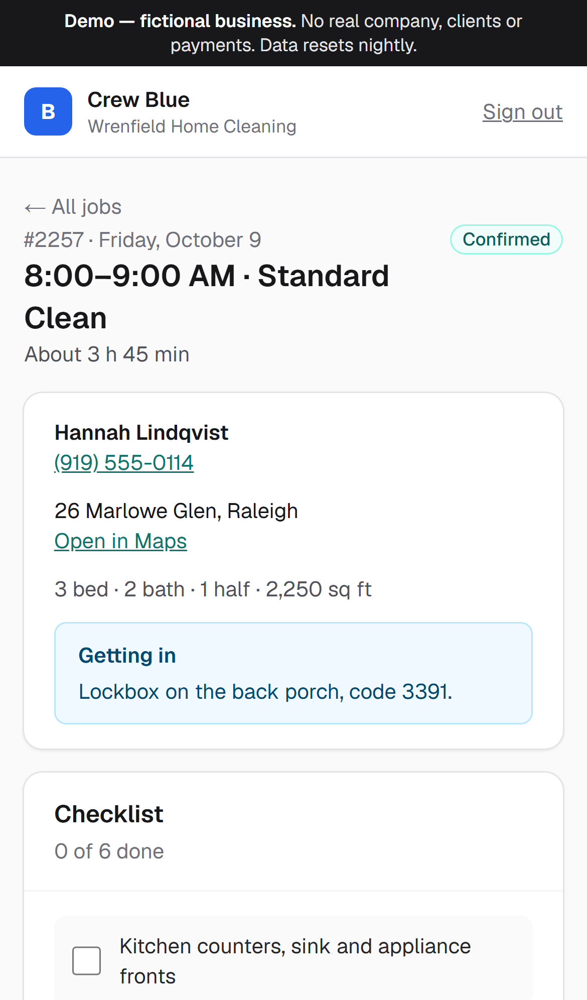
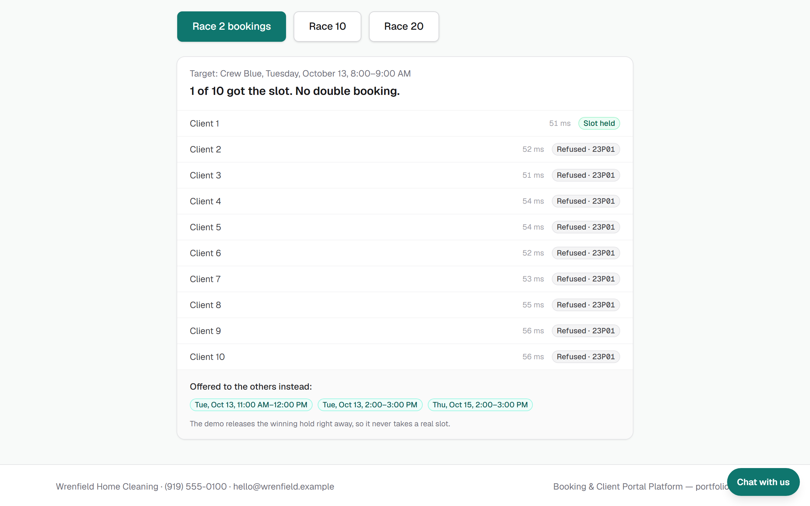
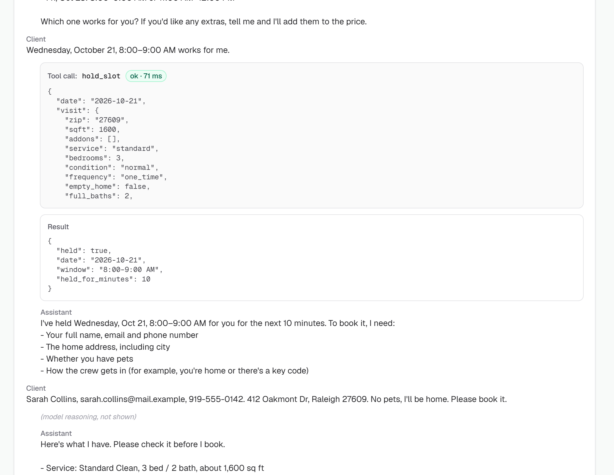
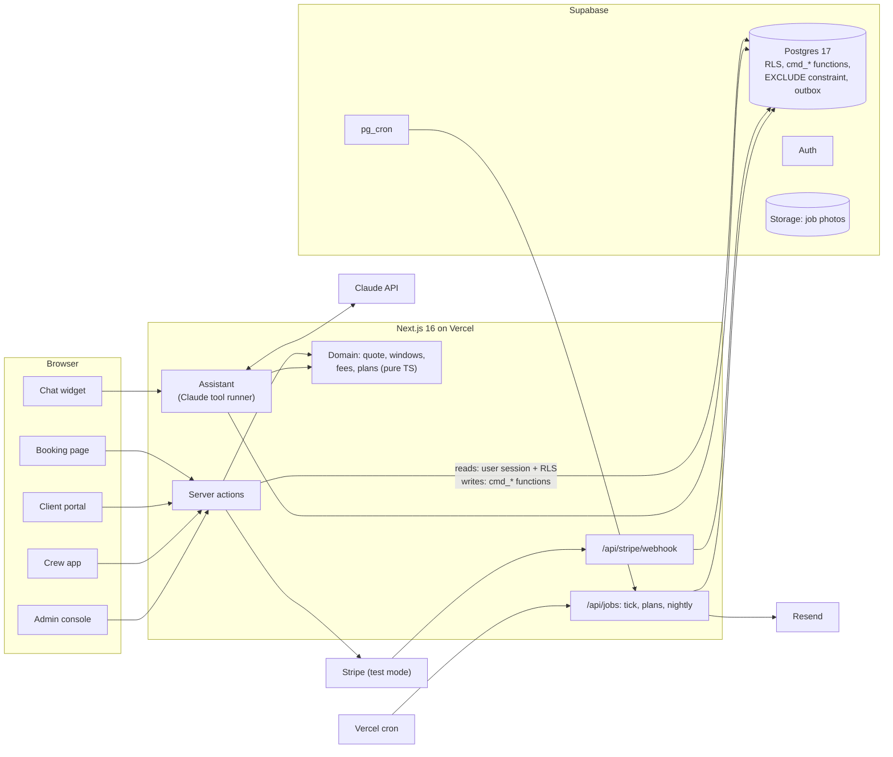

# Booking & Client Portal Platform

**Online booking with instant quotes and deposits, a client portal, a crew app, an admin console and an AI
assistant, for service businesses that send a crew to the client's home.**
A client gets a price from the business's own rules, picks a real arrival window and pays a deposit. Regular
clients reschedule, cancel or pause on their own and see any fee before they confirm. The office runs the day from a
crew calendar, and an AI assistant answers and books at any hour through the same server code as the forms.

The demo business is **Wrenfield Home Cleaning**, a fictional house-cleaning company in Raleigh, NC. The core is not
tied to cleaning: services, prices, zones, hours and cancellation terms are the business's data, and every business
is a separate tenant.

> **Status:** feature-complete. **Live demo:
> [service-booking-platform-iota.vercel.app](https://service-booking-platform-iota.vercel.app)**. Every role is one
> click away on the demo's landing page, payments run in Stripe test mode (card `4242 4242 4242 4242`), and the data
> resets every night.

<!-- Demo video goes here. -->

<table>
  <tr>
    <td width="50%">
      
      <br><sub>Booking: an instant quote and the crews' real free windows</sub>
    </td>
    <td width="50%">
      
      <br><sub>AI assistant: the price and windows come from the same server functions</sub>
    </td>
  </tr>
  <tr>
    <td>
      
      <br><sub>Admin: crew calendar; drag a visit to another crew</sub>
    </td>
    <td>
      
      <br><sub>Reports: revenue, prepaid share, cancellations, crew utilization</sub>
    </td>
  </tr>
  <tr>
    <td>
      
      <br><sub>Client portal: the fee is shown before anything changes</sub>
    </td>
    <td align="center">
      
      <br><sub>Crew app: the job, access notes and checklist on a phone</sub>
    </td>
  </tr>
  <tr>
    <td>
      
      <br><sub>Race demo: ten bookings fired at one window at once; the database lets exactly one in</sub>
    </td>
    <td>
      
      <br><sub>AI log: every tool call the assistant made, with its input and result</sub>
    </td>
  </tr>
</table>

## What a business gets

- **Bookings at 11 pm without a phone call.** The quote comes from the owner's price list (bedrooms, bathrooms,
  size, extras, frequency, travel zone), the windows come from the crews' real calendars, and a card deposit or a
  saved card secures the visit.
- **Late cancellations and lockouts stop costing money.** The terms are shown before the client confirms; the fee is
  charged to the saved card or kept from the deposit, and the balance is charged when the crew marks the job done.
- **Regular clients serve themselves.** They sign in with an e-mail link and reschedule, cancel, pause or resume a
  plan and see their receipts; there are no calls and no back-and-forth texts.
- **The office sees everything in one place.** A crew calendar with drag-and-drop, booking history, client notes,
  payments and refunds, an alert queue and reports on revenue, cancellations, crew utilization and repeat clients.
- **Crews get what they need on a phone, and nothing more.** Today's jobs, the checklist, access notes and photos,
  and only for their own crew's jobs.
- **An assistant that cannot promise what the business did not agree to.** It prices, books and reschedules through
  the server, and a booking only appears in the chat after the server has made it.
- **The owner changes prices, hours and fees alone.** These rules are versioned data with a live preview, not code.

## Guarantees, enforced and tested

| Guarantee                                | How                                                                                                                                           | Checked by                                                                                            |
| ---------------------------------------- | --------------------------------------------------------------------------------------------------------------------------------------------- | ----------------------------------------------------------------------------------------------------- |
| A crew is never booked twice             | A Postgres `EXCLUDE` constraint on each crew's time ranges (visits, slot holds and time off, with the travel buffer); no "check, then insert" | A race test: 20 simultaneous holds on one window give exactly as many winners as there are free crews |
| Each role sees only its own data         | Row-level security on every table; deny-by-default grants; writes only through SQL command functions that check the actor                     | 120 pgTAP checks                                                                                      |
| One price everywhere                     | The booking page, portal, admin and AI call the same `quote()`; each booking stores a snapshot of its quote and the rules version             | Unit tests                                                                                            |
| The AI confirms only what the server did | Booking cards in the chat are drawn from tool results; a guest's booking stays "pending payment" until the deposit succeeds                   | Integration tests and model evals                                                                     |
| A payment event is applied once          | Provider event ids are recorded; a repeat changes nothing                                                                                     | pgTAP                                                                                                 |
| Each message is sent once                | An outbox written in the same transaction as the booking event, claimed with `SKIP LOCKED`, sent with an idempotency key                      | Integration tests                                                                                     |
| A regular 8:00 visit stays at 8:00       | Plans are stored as a rule in the business's local time and expanded per date                                                                 | Unit test across the November clock change                                                            |

## The problem

A booking widget sells a time slot. A home service sells a visit whose price depends on the home, whose length
depends on that price, and whose crew has to drive there between jobs. Owners end up quoting by text, double-booking
crews in a spreadsheet, and chasing deposits and late-cancellation fees by hand. Clients who want to move a visit
have to call during office hours.

This platform makes the business's own rules the single source of truth: one function prices the visit, one
calendar per crew decides what is free, and the database refuses anything that would break it. Every screen and the
AI assistant go through the same server functions, so they cannot disagree.

## Features

**Online booking** (`/wrenfield/book`)

- Instant quote with a line-by-line breakdown, minimum visit charge, travel zone by ZIP and frequency discounts. A
  first visit is upgraded to a deep clean if the home has not had a professional clean recently.
- Arrival windows for the next weeks, computed from opening hours, holidays, crew time off and existing visits. The
  chosen window is held for 10 minutes while the client checks out.
- A one-time visit takes a card deposit (25%, at least $50). A regular plan charges nothing up front: the card is
  saved and charged after each visit.
- A "race" page fires several bookings at the same window at once and shows who won and what the others were offered.

**Payments** (Stripe in test mode, or a built-in simulator)

- Deposit at checkout, balance charged to the saved card when the job is done, cancellation and no-access fees,
  refunds from the admin console.
- Card details go from the browser straight to Stripe (Payment Element). The webhook is verified and idempotent.
- Without Stripe keys, a simulator with Stripe's test cards (success, decline, 3-D Secure, insufficient funds) runs
  the same flow, so the demo works end to end.

**Client portal** (`/portal`)

- Sign-in by e-mail link; an earlier guest booking is linked to the account by e-mail.
- Upcoming and past visits; reschedule or cancel with the exact fee shown first (free up to 48 hours before, $40
  after that, 50% within 24 hours).
- Regular plan: skip a visit, pause, resume or cancel. Billing (saved card, receipts) and profile with access
  notes.

**Crew app** (`/crew`, built for a phone)

- Today's and upcoming jobs for the cleaner's own crew; address and access notes only from a week back to two weeks
  ahead.
- Service checklist, photos uploaded to private storage, "done" (charges the balance) or "no access" (keeps a fee).

**Admin console** (`/admin`)

- Today, a day and week crew calendar with drag-and-drop between crews (the database refuses an overlap and the
  console says which crew is busy), booking details with price breakdown, payments and full history.
- Clients with notes and visit history, payments with refunds, sent messages, AI conversations with every tool call.
- Crews and time off, versioned prices and rules with a preview of the quote before publishing, a "needs attention"
  queue (failed charges, plan conflicts, AI handoffs).
- Reports for 4 or 8 weeks: earned revenue by week, service, zone and crew; share paid up front; cancellations and
  lockouts with fees kept; crew utilization; repeat clients; where bookings come from, including the AI share.

**AI assistant** (chat on the business's site and in the portal)

- Answers about services, prices, hours and the service area from the business's data; quotes, checks windows,
  holds and books. A signed-in client can also list, reschedule and cancel visits, always with a fee preview first.
- Hands a conversation to the office when it should not answer.
- Limits per message, conversation, visitor and business per day. Without an API key the chat shows as offline.

**Reminders and messages**

- Confirmation, reschedule and cancellation e-mails, and reminders 72 and 24 hours before the window (e-mail through
  Resend; SMS is written to a log only).

**Demo mode**

- A landing page with one-click sign-in for the owner, dispatcher, cleaner and client.
- Eight weeks of history and three weeks ahead are generated around today's date, and rebuilt every night.

## Architecture



**App:** Next.js 16 (App Router, Cache Components), React 19, TypeScript strict, Tailwind 4. Portal, crew and
admin pages read through the signed-in user's Supabase session, so row-level security applies to every query. Writes go through server actions
that call SQL command functions (`cmd_*`); each one checks who is acting and on which business.

**Domain:** `src/domain/` is plain TypeScript with no I/O: the quote, arrival windows, cancellation fees, plan
expansion and reports. The booking page, portal, admin, AI tools and seed data all use it. Dates and times use the
Temporal API.

**Database:** Supabase Postgres 17 with 15 migrations, 29 command functions, row-level security, a private Storage
bucket for job photos and Supabase Auth (passwords for staff, e-mail links for clients).

**Integrations behind adapters:** payments (`PaymentProvider`: Stripe or the simulator), e-mail (Resend or a log
when no key is set), the AI model (Claude, configurable). Each has a local mode, so the app runs without accounts.

## What was hard, and how it is solved

**No double bookings, under real concurrency.** The usual "is this slot free? then insert" has a gap between the two
steps. Here every crew's busy time (visits, 10-minute slot holds, time off), with the travel buffer added, lives in
one table with an `EXCLUDE USING gist` constraint on `(crew, time range)`, so Postgres itself refuses an overlap.
The first concurrent test then failed in an unexpected way: of 20 simultaneous holds on one window, 8 ended in
`deadlock detected`, 12 timed out and nobody got the slot. Nothing was double-booked, but nothing was booked either.
The fix: every command first locks the candidate crews' rows in a fixed order (ascending id), which serializes
competing requests per crew. Now 20 simultaneous holds give exactly one winner per free crew in under a second, and
the losers get the next free windows. The race page in the demo runs the same test live.

**One set of rules, many screens.** Prices, hours and cancellation terms are stored per business as versioned JSON
validated with Zod. One `quote()` serves the booking page, the portal, the admin console and the AI, and the booking
keeps a snapshot of the quote and the rules version. When the owner changes prices, existing bookings keep their
price, and the console shows which version priced each one. Fees are computed by the same function for the portal's
preview, the actual cancellation and the AI's answer.

**Time zones and the clock change.** Instants are stored in UTC and the business has an IANA time zone. Arrival
windows are computed in local time per date, so a window on November 2 is correct after the clock change. Regular
plans are stored as a rule in local time ("every other Tuesday, 8:00") and expanded into visits 60 days ahead, so
they do not drift by an hour twice a year.

**Money and payments.** Amounts are integer cents with a currency code. The deposit is charged at checkout, the
balance off-session when the job is done; a late-cancellation or no-access fee is settled against the deposit, and
only the difference is charged or refunded. Off-session charges are recorded before they are confirmed, so a
crash cannot charge a card without a trace. Provider events are applied through one idempotent SQL function: a
repeated or late webhook changes nothing, and a payment that arrives after its booking expired raises an alert
instead of silently confirming.

**An AI assistant that cannot make things up.** The model never sees a price list or a calendar in its prompt; it
calls tools, and the tools are thin wrappers over the same server functions as the forms. Every tool input is
validated on the server, and most tools use the API's strict mode, so the model cannot send a malformed call. (The
real API caps the combined size of strict schemas per request, which a local stand-in never showed: the booking
tool opts out and relies on server validation.) The slot-hold token stays on the server, a guest's booking is always "pending payment" with a payment link,
and the chat draws booking cards from tool results, not from the model's text. Cancel and reschedule tools first
return a preview of the fee and act only on a second call. Every message and tool call (input, output, success,
timing) is stored append-only and visible in the admin console. Evals cover the cases that matter: an invented
discount, a Sunday booking, an address outside the service area, someone else's booking, a price before a quote,
and calling an unpaid booking confirmed.

**Messages that arrive once.** A trigger on the booking history writes the confirmation or reminder to an outbox in
the same transaction as the change, so there is no "booked but never e-mailed" state. A sender claims due messages
with `FOR UPDATE SKIP LOCKED` (safe to run twice at once) and sends with an idempotency key. Reminder keys include
the window, so a rescheduled visit gets new reminders and the old ones are dropped.

**Row-level security that holds for writes too.** Tables grant nothing by default. Reads go through row-level
security with the user's session: a client sees their own homes and visits, a cleaner sees addresses only for their
crew's jobs within a date window, staff see their own business. No table accepts a direct insert or update from a
browser; writes go through `security definer` functions that check the actor's role and business. The pgTAP suite
tries the forbidden paths as each role.

## Keep your Jobber or Acuity — add a portal and AI

Many businesses already run on a field-service or scheduling tool and do not want to move. The portal and the
assistant here talk to the booking core through a narrow set of server functions: quote, list windows, hold, book,
reschedule, cancel. Pointing those functions at an existing tool's API keeps the client portal, the crew view and
the AI assistant as they are; the guarantees then depend on what that tool's API enforces. This adapter is not part
of the demo, which runs on its own core.

## Tests

- **50 unit tests** (Vitest): quotes, arrival windows, cancellation fees, plan expansion across the clock change,
  reports.
- **120 pgTAP checks**: grants, row-level security by role and business, the overlap constraint, payments, the
  portal, crew operations and notifications.
- **29 integration tests** against the local Supabase stack: the concurrent double-booking race, booking and
  payment, portal changes, crew operations, the outbox, the AI tools, and a full chat turn against a local stand-in
  for the Messages API.
- **End-to-end** (Playwright): a guest books, has a card declined, pays the deposit, and the owner sees the booking.
- **Stripe test mode**: a deposit with a test card, the balance charged off-session to the saved card, a partial
  refund, and a saved plan card that later declines and alerts the office. Stripe's own events go through the
  webhook's signature check and handling.
- **AI evals**: 6 adversarial scenarios against the real model; each writes its transcript and token cost to
  `test-results/ai-eval.md`.

```bash
npm run check        # typecheck, lint, format check, unit tests
npm run test:db      # pgTAP and integration tests (needs the local Supabase stack)
npm run test:e2e     # Playwright, against the seeded demo business
npm run test:stripe  # payment flows against Stripe test mode, needs test keys
npm run eval:ai      # AI evals, needs ANTHROPIC_API_KEY
```

## Cost of the assistant

Measured in the eval runs on Claude Sonnet 5.5 at medium effort, at list prices ($2 / $10 per million input /
output tokens) as of October 2026, each conversation starting with a cold prompt cache:

| Conversation                       | Tool calls | Cost     |
| ---------------------------------- | ---------- | -------- |
| One question with a quote          | 3          | ≈ $0.025 |
| Three messages ending in a booking | 6          | ≈ $0.057 |

The system prompt and tool definitions (about 7,500 tokens) are cached, so conversations that follow within a few
minutes pay a tenth of the input price for them. The model is one setting (`ANTHROPIC_MODEL`); per-visitor and
per-business daily limits plus a spending limit on the API key cap the cost of a public demo.

## Running it locally

Requirements: Node.js 24 and Docker Desktop. No accounts are needed: without Stripe, Resend and Anthropic keys,
payments run in the simulator, e-mail goes to a log and the chat shows as offline.

```bash
npm install
npm run db:start               # local Supabase (API :44321, Studio :44323, mail :44324)
cp .env.example .env.local     # fill in the local keys printed by `npm run db:status`
npm run db:seed                # the demo business with eight weeks of history
npm run dev                    # http://localhost:3000
npm run jobs:local             # optional: reminders, holds and plans on a schedule
npm run stripe:listen          # optional, with Stripe test keys: forwards webhooks (needs the Stripe CLI)
```

For a deployment, `supabase/schedule-jobs.sql` sets up the every-minute job in Supabase, and `vercel.json` runs the
nightly demo reset.

## Project layout

```
src/app/            pages: the business's site and booking, portal, crew, admin, API routes
src/domain/         pure logic: quote, windows, fees, plans, reports (unit-tested)
src/server/         server code: booking, payments, plans, notifications, AI assistant, jobs
src/ui/             UI components
src/demo/           the demo business, its history generator and the nightly reset
supabase/migrations schema, row-level security, command functions
supabase/tests/     pgTAP
tests/              integration, end-to-end and AI eval tests
```

## Later

Ideas kept out of scope on purpose:

- WhatsApp or a voice line on the same AI tools.
- An adapter that lets the assistant book into an existing calendar (Google Calendar or Cal.com).
- A second tenant with a different booking model: a studio with classes, seats and credits.
- Custom estimates: a request with photos, a priced estimate, acceptance in the portal (today a home in heavy
  condition is flagged for the office to review).
- Stripe Connect, so each business on the platform gets paid into its own account.
- Real SMS reminders (today they are written to a log).
- Short-term rental turnovers. Set aside for now: syncing with Airbnb through iCal cannot keep the "never booked
  twice" guarantee.

## License

[MIT](LICENSE)
